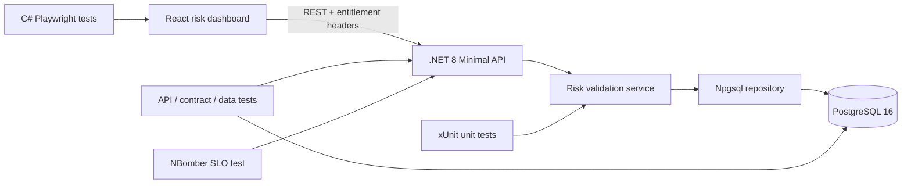

# C# Risk Feed API Automation Framework

A production-style quality engineering portfolio project for a financial risk
feed. It contains a real .NET 8 API and React dashboard as the system under
test, plus C# automation for REST, PostgreSQL, OpenAPI contracts, desktop and
mobile UI, and performance.

The repository is designed to demonstrate the hands-on skills expected of an
Automation QA Engineer working on data-heavy financial products: **risk feed
validation**, **data quality**, entitlement checks, **contract checks**,
failure triage, and a layered **CI quality gate**.

## Verified baseline

The completed local quality run on 26 July 2026 produced:

- build: 0 warnings and 0 errors;
- unit: 22/22 passed with 91.48% line coverage on `RiskFeed.Core`;
- API / contract / PostgreSQL: 10/10 passed;
- C# Playwright: 3/3 passed across desktop, portfolio refresh, and mobile;
- NBomber smoke: 50/50 successful requests, 0% errors, and 58.59 ms p95.

The NBomber number is a local smoke baseline, not a general production
benchmark. The committed CI thresholds remain the reproducible release signal.

## What this proves

| StoneX-relevant capability | Evidence in this repository |
|---|---|
| Strong C# / .NET coding | Clean architecture across Core, Infrastructure, API, and four C# test projects |
| REST and service automation | Positive, negative, error-contract, idempotency, filtering, and authorization tests |
| Data pipeline quality | Freshness, range, format, duplicate, and sequence-gap validation |
| SQL Server / PostgreSQL validation | Real PostgreSQL 16 integration tests and direct API-to-database reconciliation |
| Contract testing | Generated OpenAPI 3 contract with automated route and response assertions |
| Playwright UI automation | C# Playwright coverage for chart rendering, live filters, and a 390px mobile viewport |
| Performance and reliability | NBomber arrival-rate load model with error-rate and p95 latency thresholds |
| CI/CD ownership | GitHub Actions build, formatting, coverage, integration, UI, and scheduled performance gates |
| Docker / production readiness | Multi-stage non-root image, health checks, read-only API filesystem, and Compose |

## System under test



The API models intraday Value at Risk events. It rejects malformed or stale
events before storage, enforces unique portfolio sequences in PostgreSQL,
requires `risk:read` or `risk:write` entitlements, and exposes an auditable
quality summary with every feed response.

## Repository layout

```text
src/
  RiskFeed.Core/             Domain types, quality rules, service layer
  RiskFeed.Infrastructure/   Npgsql repository, schema, seed, DB health
  RiskFeed.Api/              REST endpoints, OpenAPI, auth filter, middleware
  RiskFeed.Web/              Responsive React/TypeScript risk dashboard
tests/
  RiskFeed.UnitTests/        Fast rule and service tests
  RiskFeed.IntegrationTests/ Real API + PostgreSQL + contract + data checks
  RiskFeed.UiTests/          C# Playwright desktop and mobile tests
  RiskFeed.PerformanceTests/ NBomber load profile and SLO thresholds
docs/                        Strategy, traceability, defect and résumé evidence
```

## Run and verify locally

This guide assumes Windows and PowerShell. On macOS or Linux, use `curl` instead
of `curl.exe` and adjust path separators. Run every command from the repository
root.

### 1. Check the prerequisites

Install and start the following tools:

| Tool | Required version | Check |
|---|---:|---|
| .NET SDK | 8.x | `dotnet --version` |
| Docker Desktop | Current stable | `docker version` |
| Node.js | 22+ | `node --version` |
| PowerShell | 7+ | `pwsh --version` |

Open PowerShell in the cloned project:

```powershell
cd "C:\path\to\CSharp_RiskFeed_Automation"
dotnet --version
docker version
node --version
```

Docker must be running before integration, UI, or performance tests are
started.

### 2. Start the application

```powershell
docker compose up --build -d
docker compose ps
```

Wait until both `postgres` and `api` report `healthy`. If either service does
not start, inspect its logs:

```powershell
docker compose logs --tail 100 api
docker compose logs --tail 50 postgres
```

Open the following pages:

| Page | URL | Expected result |
|---|---|---|
| React dashboard | [http://localhost:8088](http://localhost:8088) | Risk feed control room |
| Swagger UI | [http://localhost:8088/swagger](http://localhost:8088/swagger) | Three risk-feed operations |
| OpenAPI contract | [http://localhost:8088/swagger/v1/swagger.json](http://localhost:8088/swagger/v1/swagger.json) | OpenAPI JSON |
| Readiness | [http://localhost:8088/health/ready](http://localhost:8088/health/ready) | `Healthy` |
| Liveness | [http://localhost:8088/health/live](http://localhost:8088/health/live) | `{"status":"Healthy"}` |

Compose uses local-demo credentials. Before using a shared environment, copy
`.env.example` to `.env`, replace the password, and never commit `.env`.

### 3. Check the dashboard manually

Use this short acceptance checklist:

| Scenario | Expected result |
|---|---|
| Open `PF-ALPHA` | Quality `PASS`, 10 validated records, chart visible, 8 table rows |
| Select `PF-BETA` | Quality `PASS`, 8 validated records, chart refreshes, first row contains `XAUUSD` |
| Use Chrome DevTools at `390 x 844` | Portfolio control and chart remain visible with no horizontal scrollbar |

### 4. Check the REST API manually

An entitled read must return `200 OK`, an `X-Correlation-ID` header, records in
descending sequence order, quality status `Pass`, and zero sequence gaps:

```powershell
curl.exe -i `
  -H "X-Client-Id: manual-tester" `
  -H "X-Entitlements: risk:read" `
  "http://localhost:8088/api/v1/risk-feed?portfolioId=PF-ALPHA&limit=5"
```

Check the negative security and query paths:

```powershell
# Expected: 401 Unauthorized
curl.exe -i `
  "http://localhost:8088/api/v1/risk-feed?portfolioId=PF-ALPHA"

# Expected: 403 Forbidden
curl.exe -i `
  -H "X-Client-Id: manual-tester" `
  -H "X-Entitlements: profile:read" `
  "http://localhost:8088/api/v1/risk-feed?portfolioId=PF-ALPHA"

# Expected: 400 Bad Request
curl.exe -i `
  -H "X-Client-Id: manual-tester" `
  -H "X-Entitlements: risk:read" `
  "http://localhost:8088/api/v1/risk-feed?portfolioId=PF-ALPHA&limit=501"
```

Create a unique, valid event:

```powershell
$eventId = [guid]::NewGuid()
$sequence = [DateTimeOffset]::UtcNow.ToUnixTimeMilliseconds()
$body = @{
    eventId     = $eventId.ToString()
    portfolioId = "PF-MANUAL"
    instrument  = "EURUSD"
    metric      = "ValueAtRisk95"
    value       = 125000.50
    currency    = "USD"
    asOfUtc     = (Get-Date).ToUniversalTime().AddSeconds(-5).ToString("o")
    sequence    = $sequence
    source      = "manual-verification"
} | ConvertTo-Json -Compress

curl.exe -i `
  -X POST `
  -H "Content-Type: application/json" `
  -H "X-Client-Id: manual-tester" `
  -H "X-Entitlements: risk:write" `
  --data-raw $body `
  "http://localhost:8088/api/v1/risk-feed"
```

Expect `201 Created` and a `Location` header. Read the stored event:

```powershell
curl.exe -i `
  -H "X-Client-Id: manual-tester" `
  -H "X-Entitlements: risk:read" `
  "http://localhost:8088/api/v1/risk-feed/$eventId"
```

Expect `200 OK` and the same event values. Repeat the previous POST without
changing `$body`; the database uniqueness rule must return `409 Conflict`.

Check data-quality rejection with deliberately invalid data:

```powershell
$badBody = @{
    eventId     = ([guid]::NewGuid()).ToString()
    portfolioId = "pf-invalid"
    instrument  = "BAD INSTRUMENT"
    metric      = "ValueAtRisk95"
    value       = -10
    currency    = "US"
    asOfUtc     = (Get-Date).ToUniversalTime().AddMinutes(5).ToString("o")
    sequence    = 0
    source      = "INVALID SOURCE"
} | ConvertTo-Json -Compress

curl.exe -i `
  -X POST `
  -H "Content-Type: application/json" `
  -H "X-Client-Id: manual-tester" `
  -H "X-Entitlements: risk:write" `
  --data-raw $badBody `
  "http://localhost:8088/api/v1/risk-feed"
```

Expect `422 Unprocessable Entity` with errors for `portfolioId`, `instrument`,
`currency`, `asOfUtc`, and `sequence`.

### 5. Confirm API-to-database consistency

Query PostgreSQL independently and confirm that it contains exactly one row
matching the event created above:

```powershell
docker compose exec -T postgres psql `
  -U riskfeed `
  -d riskfeed `
  -c "SELECT event_id, portfolio_id, instrument, metric, risk_value, currency, sequence_no, source FROM risk_events WHERE event_id = '$eventId';"
```

View the record and sequence ranges for every portfolio:

```powershell
docker compose exec -T postgres psql `
  -U riskfeed `
  -d riskfeed `
  -c "SELECT portfolio_id, COUNT(*) AS records, MIN(sequence_no) AS min_sequence, MAX(sequence_no) AS max_sequence FROM risk_events GROUP BY portfolio_id ORDER BY portfolio_id;"
```

### 6. Run the main quality gate

This single script restores locked dependencies, checks formatting, builds with
warnings treated as errors, enforces unit coverage, runs the API/contract/
PostgreSQL tests, and type-checks and builds React:

```powershell
pwsh -NoProfile -ExecutionPolicy Bypass `
  -File .\scripts\run-quality-gate.ps1
```

Expected final line: `CI QUALITY GATE PASSED`.

| Gate | Expected baseline |
|---|---|
| Build | 0 warnings and 0 errors |
| Unit tests | 22 passed; at least 80% line coverage (`RiskFeed.Core` baseline: 91.48%) |
| API, OpenAPI contract, entitlement, and PostgreSQL | 10 passed |
| React | Type-check and production build passed |

To run only one test layer while troubleshooting:

```powershell
dotnet test tests/RiskFeed.UnitTests -c Release `
  /p:CollectCoverage=true `
  /p:CoverletOutputFormat=cobertura `
  /p:Threshold=80 `
  /p:ThresholdType=line

# Docker is required because Testcontainers starts a disposable PostgreSQL.
dotnet test tests/RiskFeed.IntegrationTests -c Release
```

The integration suite compares HTTP results with direct PostgreSQL queries, so
an API assertion cannot hide a persistence or mapping defect.

### 7. Run the C# Playwright UI tests

Keep Compose running, build the tests, and install Chromium once:

```powershell
dotnet build tests/RiskFeed.UiTests -c Release
pwsh tests/RiskFeed.UiTests/bin/Release/net8.0/playwright.ps1 install chromium

$env:UI_BASE_URL = "http://localhost:8088"
$env:UI_ARTIFACT_DIR = "$PWD\.artifacts\ui"
dotnet test tests/RiskFeed.UiTests -c Release --no-build
```

Expect 3 passed tests covering the desktop dashboard, portfolio refresh, and
mobile layout. Screenshots are written to `.artifacts/ui/`.

### 8. Run the NBomber performance gate

Keep Compose running:

```powershell
dotnet run --project tests/RiskFeed.PerformanceTests -c Release
```

The default profile sends 25 requests/second for 30 seconds and passes only
when failures are below 1% and p95 latency is below 300 ms. Override the
defaults with `PERF_RATE`, `PERF_DURATION_SECONDS`,
`PERF_MAX_ERROR_PERCENT`, and `PERF_MAX_P95_MS`.

Expect `PERFORMANCE GATE PASSED`. HTML evidence is written to
`.artifacts/performance/`. NBomber's current license permits personal/hobby
portfolio use; organizations should review its commercial terms before
adopting this suite internally.

### 9. Stop or reset the environment

Stop the services but keep the demo database:

```powershell
docker compose down
```

Delete the services and demo database for a completely fresh run:

```powershell
docker compose down --volumes
```

Use `--volumes` only when deleting the local PostgreSQL data is intentional.

## CI quality gate

Pull requests cannot be considered release-ready until the workflow has:

1. restored locked dependencies;
2. passed `dotnet format --verify-no-changes`;
3. compiled with warnings treated as errors;
4. passed unit tests with an 80% line-coverage floor;
5. passed REST, OpenAPI contract checks, entitlement, and PostgreSQL tests;
6. type-checked and built the React application;
7. passed C# Playwright desktop and mobile scenarios against the containerized
   production build.

The NBomber performance workflow runs weekly and on demand. It fails when its
latency or error-budget threshold is breached and uploads the HTML report as
release evidence.

## Engineering decisions

- **Real database, disposable tests.** Testcontainers gives repeatable
  PostgreSQL behavior without mocks or shared test data.
- **Defense in depth.** C# quality rules provide actionable 422 errors while
  database constraints independently protect integrity.
- **Entitlements are testable.** Header-based demo identity keeps the portfolio
  self-contained while still covering 401, 403, read, and write permission
  paths. A production deployment would replace this filter with OAuth2/JWT.
- **Deterministic diagnostics.** Correlation IDs are returned on every request,
  structured logs include the same ID, and tests preserve TRX/container/load
  evidence.
- **Fast feedback first.** Unit and contract checks run before the more
  expensive browser and scheduled performance stages.

## Quality documentation

- [Test strategy](docs/test-strategy.md)
- [Requirement-to-test traceability](docs/traceability-matrix.md)
- [Example defect report](docs/sample-defect.md)
- [Architecture decisions](docs/architecture-decisions.md)
- [AI-assisted testing approach](docs/ai-assisted-testing.md)
- [Verification evidence](docs/verification-evidence.md)
- [Résumé-ready project entry](docs/resume-addition.md)

## Scope boundaries

This is an intentionally credible intermediate portfolio system, not a claim
to be a bank's complete production risk platform. Demo identity headers stand
in for an identity provider; PostgreSQL stands in for a full streaming
topology; and generated seed events stand in for a risk engine. The quality
architecture is designed so Kafka, gRPC, Pact, Azure, and Kubernetes can be
added without rewriting the domain rules or test layers.

## License

Source code in this repository is available under the [MIT License](LICENSE).
Third-party dependencies retain their own licenses.
