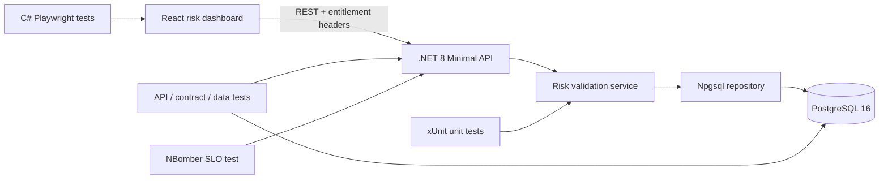

# C# Risk Feed API Automation Framework

A production-style quality engineering portfolio project for a financial risk
feed. It contains a real .NET 8 API and React dashboard as the system under
test, plus C# automation for REST, PostgreSQL, OpenAPI contracts, desktop and
mobile UI, and performance.

The repository is designed to demonstrate the hands-on skills expected of an
Automation QA Engineer working on data-heavy financial products: **risk feed
validation**, **data quality**, entitlement checks, **contract checks**,
failure triage, and a layered **CI quality gate**.

## Verified baseline

The completed local quality run on 26 July 2026 produced:

- build: 0 warnings and 0 errors;
- unit: 22/22 passed with 91.48% line coverage on `RiskFeed.Core`;
- API / contract / PostgreSQL: 10/10 passed;
- C# Playwright: 3/3 passed across desktop, portfolio refresh, and mobile;
- NBomber smoke: 50/50 successful requests, 0% errors, and 58.59 ms p95.

The NBomber number is a local smoke baseline, not a general production
benchmark. The committed CI thresholds remain the reproducible release signal.

## What this proves

| StoneX-relevant capability | Evidence in this repository |
|---|---|
| Strong C# / .NET coding | Clean architecture across Core, Infrastructure, API, and four C# test projects |
| REST and service automation | Positive, negative, error-contract, idempotency, filtering, and authorization tests |
| Data pipeline quality | Freshness, range, format, duplicate, and sequence-gap validation |
| SQL Server / PostgreSQL validation | Real PostgreSQL 16 integration tests and direct API-to-database reconciliation |
| Contract testing | Generated OpenAPI 3 contract with automated route and response assertions |
| Playwright UI automation | C# Playwright coverage for chart rendering, live filters, and a 390px mobile viewport |
| Performance and reliability | NBomber arrival-rate load model with error-rate and p95 latency thresholds |
| CI/CD ownership | GitHub Actions build, formatting, coverage, integration, UI, and scheduled performance gates |
| Docker / production readiness | Multi-stage non-root image, health checks, read-only API filesystem, and Compose |

## System under test



The API models intraday Value at Risk events. It rejects malformed or stale
events before storage, enforces unique portfolio sequences in PostgreSQL,
requires `risk:read` or `risk:write` entitlements, and exposes an auditable
quality summary with every feed response.

## Repository layout

```text
src/
  RiskFeed.Core/             Domain types, quality rules, service layer
  RiskFeed.Infrastructure/   Npgsql repository, schema, seed, DB health
  RiskFeed.Api/              REST endpoints, OpenAPI, auth filter, middleware
  RiskFeed.Web/              Responsive React/TypeScript risk dashboard
tests/
  RiskFeed.UnitTests/        Fast rule and service tests
  RiskFeed.IntegrationTests/ Real API + PostgreSQL + contract + data checks
  RiskFeed.UiTests/          C# Playwright desktop and mobile tests
  RiskFeed.PerformanceTests/ NBomber load profile and SLO thresholds
docs/                        Strategy, traceability, defect and résumé evidence
```

## Run it

Prerequisites: .NET 8 SDK, Docker Desktop, and Node.js 22+.

```bash
docker compose up --build
```

Open:

- Dashboard: [http://localhost:8088](http://localhost:8088)
- Swagger UI: [http://localhost:8088/swagger](http://localhost:8088/swagger)
- Readiness: [http://localhost:8088/health/ready](http://localhost:8088/health/ready)

The default Compose credentials are local-demo values. Copy `.env.example` to
`.env` and replace the password before using a shared environment.

An authorized request looks like:

```bash
curl \
  -H "X-Client-Id: portfolio-demo" \
  -H "X-Entitlements: risk:read" \
  "http://localhost:8088/api/v1/risk-feed?portfolioId=PF-ALPHA&limit=10"
```

Stop the stack with:

```bash
docker compose down
```

Use `docker compose down --volumes` only when you also want to remove the local
demo database.

## Test execution

### Unit quality gate

```bash
dotnet test tests/RiskFeed.UnitTests \
  --configuration Release \
  /p:CollectCoverage=true \
  /p:CoverletOutputFormat=cobertura \
  /p:Threshold=80 \
  /p:ThresholdType=line
```

### API, contract, and PostgreSQL tests

These tests use Testcontainers and need Docker:

```bash
dotnet test tests/RiskFeed.IntegrationTests --configuration Release
```

They verify the HTTP result and then query PostgreSQL independently so a
passing API assertion cannot hide a persistence or mapping defect.

### C# Playwright tests

Start the Compose stack, build the test project, install Chromium once, and run:

```powershell
dotnet build tests/RiskFeed.UiTests -c Release
pwsh tests/RiskFeed.UiTests/bin/Release/net8.0/playwright.ps1 install chromium
dotnet test tests/RiskFeed.UiTests -c Release --no-build
```

### NBomber performance gate

With the Compose stack running:

```bash
dotnet run --project tests/RiskFeed.PerformanceTests -c Release
```

Defaults: 25 requests/second for 30 seconds, less than 1% failures, and p95
under 300 ms. Override with `PERF_RATE`, `PERF_DURATION_SECONDS`,
`PERF_MAX_ERROR_PERCENT`, and `PERF_MAX_P95_MS`. HTML evidence is written to
`.artifacts/performance/`.

NBomber's current license permits personal/hobby portfolio use; organizations
should review its commercial terms before adopting this suite internally.

## CI quality gate

Pull requests cannot be considered release-ready until the workflow has:

1. restored locked dependencies;
2. passed `dotnet format --verify-no-changes`;
3. compiled with warnings treated as errors;
4. passed unit tests with an 80% line-coverage floor;
5. passed REST, OpenAPI contract checks, entitlement, and PostgreSQL tests;
6. type-checked and built the React application;
7. passed C# Playwright desktop and mobile scenarios against the containerized
   production build.

The NBomber performance workflow runs weekly and on demand. It fails when its
latency or error-budget threshold is breached and uploads the HTML report as
release evidence.

## Engineering decisions

- **Real database, disposable tests.** Testcontainers gives repeatable
  PostgreSQL behavior without mocks or shared test data.
- **Defense in depth.** C# quality rules provide actionable 422 errors while
  database constraints independently protect integrity.
- **Entitlements are testable.** Header-based demo identity keeps the portfolio
  self-contained while still covering 401, 403, read, and write permission
  paths. A production deployment would replace this filter with OAuth2/JWT.
- **Deterministic diagnostics.** Correlation IDs are returned on every request,
  structured logs include the same ID, and tests preserve TRX/container/load
  evidence.
- **Fast feedback first.** Unit and contract checks run before the more
  expensive browser and scheduled performance stages.

## Quality documentation

- [Test strategy](docs/test-strategy.md)
- [Requirement-to-test traceability](docs/traceability-matrix.md)
- [Example defect report](docs/sample-defect.md)
- [Architecture decisions](docs/architecture-decisions.md)
- [AI-assisted testing approach](docs/ai-assisted-testing.md)
- [Verification evidence](docs/verification-evidence.md)
- [Résumé-ready project entry](docs/resume-addition.md)

## Scope boundaries

This is an intentionally credible intermediate portfolio system, not a claim
to be a bank's complete production risk platform. Demo identity headers stand
in for an identity provider; PostgreSQL stands in for a full streaming
topology; and generated seed events stand in for a risk engine. The quality
architecture is designed so Kafka, gRPC, Pact, Azure, and Kubernetes can be
added without rewriting the domain rules or test layers.

## License

Source code in this repository is available under the [MIT License](LICENSE).
Third-party dependencies retain their own licenses.
